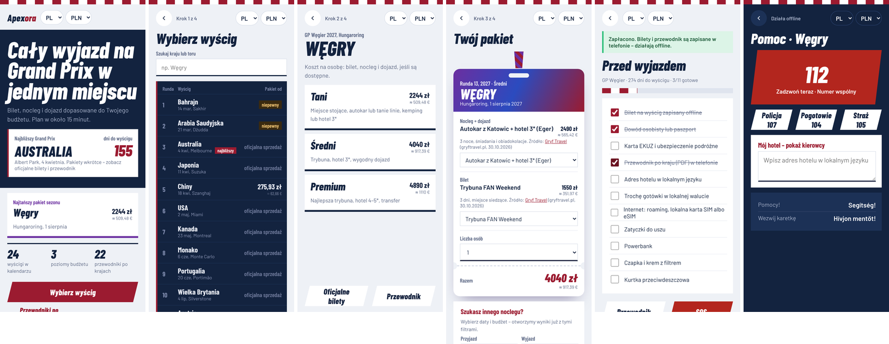
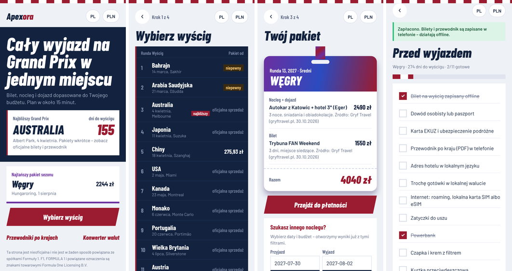

# Apexora

**Live demo: https://dianahotilovich.github.io/apexora/**

**Plan a whole Formula 1 Grand Prix trip in one place: ticket, stay and getting there, matched to your budget, in your currency and language.**

Apexora is a portfolio and university project (VIZJA, *Zarządzanie projektem produktu cyfrowego*, 2026). It covers the full 2027 F1 calendar (24 races), three budget levels, real sourced offers, flexible payments and offline country guides for the race weekend.



## What works

| Feature | Web | Mobile | API |
|---|---|---|---|
| 2027 calendar with "uncertain" races flagged | yes | yes | `GET /api/races` |
| Budget / Standard / Premium packages from real, dated offers | yes | yes | `GET /api/races/:id/offers?level=` |
| Swap any part of the package, choose number of travellers | yes | – | `POST /api/trips/quote` |
| Every price in your currency plus EUR (ECB rates, offline snapshot) | yes | yes | `GET /api/rates` |
| Payment: pay now, instalments (only where a partner exists), save-up plan, split | yes | yes | `GET /api/payments/methods`, `POST /api/payments` |
| Adyen Checkout in **test mode** (or a built-in test provider without keys) | – | – | `POST /api/payments` |
| Pre-trip checklist (EU vs non-EU, season-aware), saved on the device | yes | yes | `GET /api/guides/:code/checklist` |
| 22 country guides: emergency numbers, SIM, transport, money, phrases; A5 PDF download | yes | yes | `GET /api/guides/:code` |
| SOS screen: one-tap call, hotel address for the driver, phrases – works offline | yes | yes | – |
| Currency converter, offline | yes | yes | – |
| Beta waitlist | yes | – | `POST /api/waitlist` |
| Polish and English UI | yes | yes | – |

No real money is ever taken: payments run in test mode only.

## Architecture

```
packages/shared   TypeScript domain: races, offers, rates, trip builder, payments rules, checklists, guides, i18n
apps/api          NestJS + Drizzle ORM + PostgreSQL (embedded PGlite for dev/tests), zod validation
apps/web          Next.js 15 / React 19, static export, PWA with offline service worker
apps/mobile       Expo (React Native), AsyncStorage offline cache
```

The web and mobile apps share all business logic through `@apexora/shared`, so prices, payment rules and checklists are identical everywhere. The web app runs in **demo mode** (fully in the browser, no server) or against the API when `NEXT_PUBLIC_API_URL` is set.

## Run it

Requirements: Node.js 20+ (22 recommended).

```bash
npm install
npm run build:shared

# Web app in demo mode -> http://localhost:3000
npm run dev:web

# API with embedded Postgres -> http://localhost:4000/api/health
npm run dev:api
```

Web app connected to the API:

```bash
NEXT_PUBLIC_API_URL=http://localhost:4000 npm run dev:web
```

Mobile app (Expo Go on your phone, or `w` for the browser):

```bash
cd apps/mobile && npm install && npx expo start
```

Everything with Docker (Postgres + API + web):

```bash
docker compose up --build   # -> http://localhost:3000
```

Configuration: see [.env.example](.env.example).

## Tests

```bash
npm test                                   # shared logic (vitest) + API end-to-end (node:test + supertest, real Postgres engine)
npm run build -w @apexora/web && npm run test:e2e -w @apexora/web   # browser flow: race -> package -> payment -> checklist -> SOS
cd apps/mobile && npx tsc --noEmit         # mobile type-check
```

CI runs all of the above on every push (`.github/workflows/ci.yml`).

## Data and sources

Offers and prices come from public pages of ticket sellers and tour operators, each stored with its source and check date (October 2026); estimates are labelled as estimates. Exchange rates: ECB reference rates via Frankfurter, with an ECB snapshot from 30.10.2026 for offline use. Country guides: official emergency-service and operator pages, October 2026.

This website is unofficial and is not associated in any way with the Formula 1 companies. F1, FORMULA ONE, FORMULA 1 and related marks are trade marks of Formula One Licensing B.V.

## Mobile



## License

All rights reserved – see [LICENSE](LICENSE). The code is public for portfolio review only.
